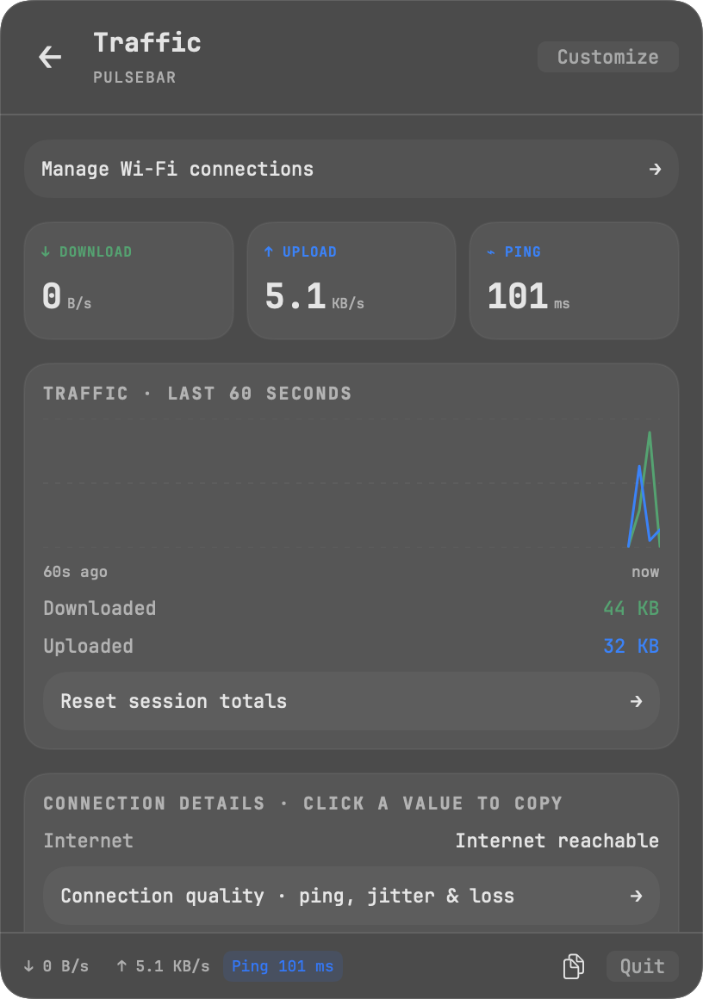
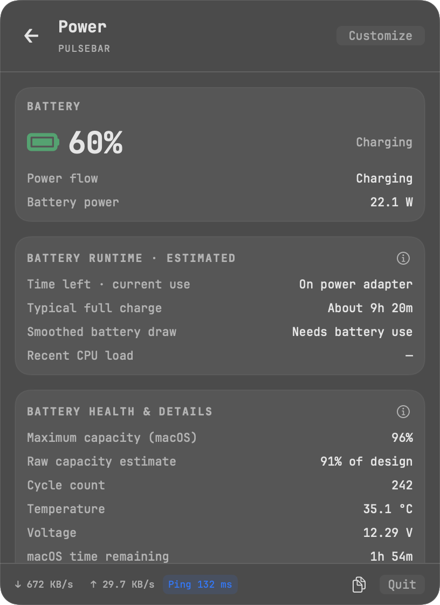
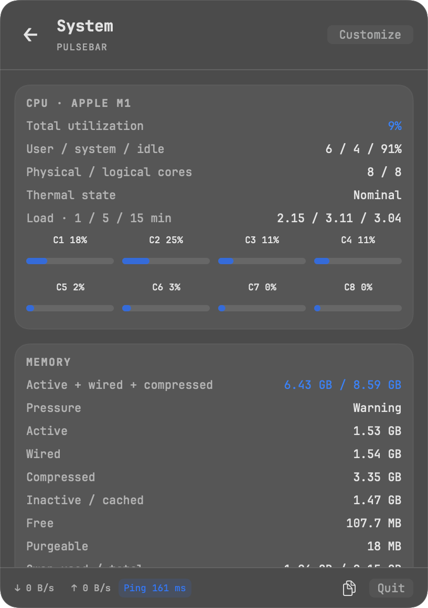

<h1 align="center">PulseBar</h1>
<p align="center">Network speed, battery insights, and everyday controls in your Mac’s menu bar.</p>
<p align="center"><strong>macOS 13+ · Native Swift · MIT license</strong></p>

<p align="center">
  
  
  
</p>

## At a glance

- **Network:** live upload/download speeds, traffic history, ping, jitter, packet loss, and outage detection.
- **Battery:** charging state, power flow, health, time left at current use, and learned typical runtime.
- **Controls:** join Wi-Fi networks, adjust volume and brightness, or keep your Mac awake.
- **Make it yours:** independent menu bar items, hide unused modules, choose a theme, and copy metrics with a click.

Inspired by [Omarchy](https://github.com/omacom/omarchy), with a neutral translucent macOS appearance. JetBrainsMono Nerd Font is bundled inside the app.

## Build and run

Requires Apple’s Swift 5.9+ Command Line Tools. No Homebrew or third-party packages.
From the folder containing `Package.swift`:

```sh
zsh build.sh
open dist/PulseBar.app
```

Move `PulseBar.app` into **Applications**, then enable **Launch at login** in Customize if wanted. Hold **⌘** and drag menu bar items to reorder them.

Builds are locally ad-hoc signed; a notarized download is not currently provided.

## A few useful details

Visible system and power metrics refresh every second; background sampling is lighter. Battery runtime estimates learn from actual discharge and stay smoothed to avoid jumping around.

Wi-Fi names can require Location permission. Enabled connectivity checks contact Cloudflare/Google; weather requests use Open-Meteo. Fonts are loaded only inside PulseBar.

[Usage, formulas & development →](Docs/GUIDE.md) · [Omarchy feature mapping →](OMARCHY-FUNCTIONS.md)

## Development and credits

Run `zsh test.sh` for the regression checks. Compiler caches stay inside `.build-local/` and can be deleted after building.

[MIT licensed](LICENSE). Includes code adapted from [Stats](https://github.com/exelban/stats), Omarchy-inspired patterns, and JetBrains Mono Nerd Font. See [third-party notices](THIRD-PARTY-NOTICES.md).
